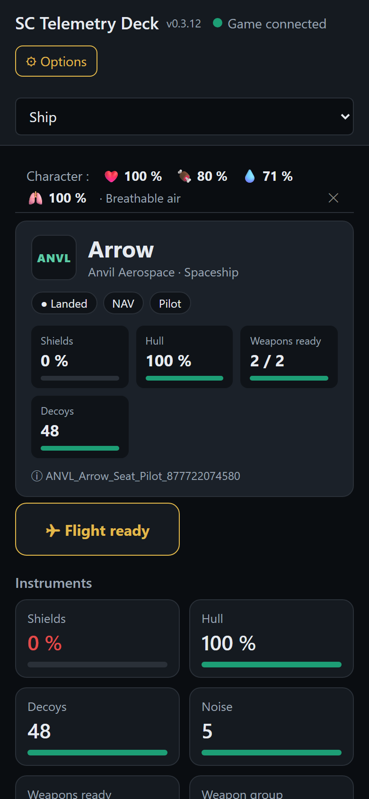
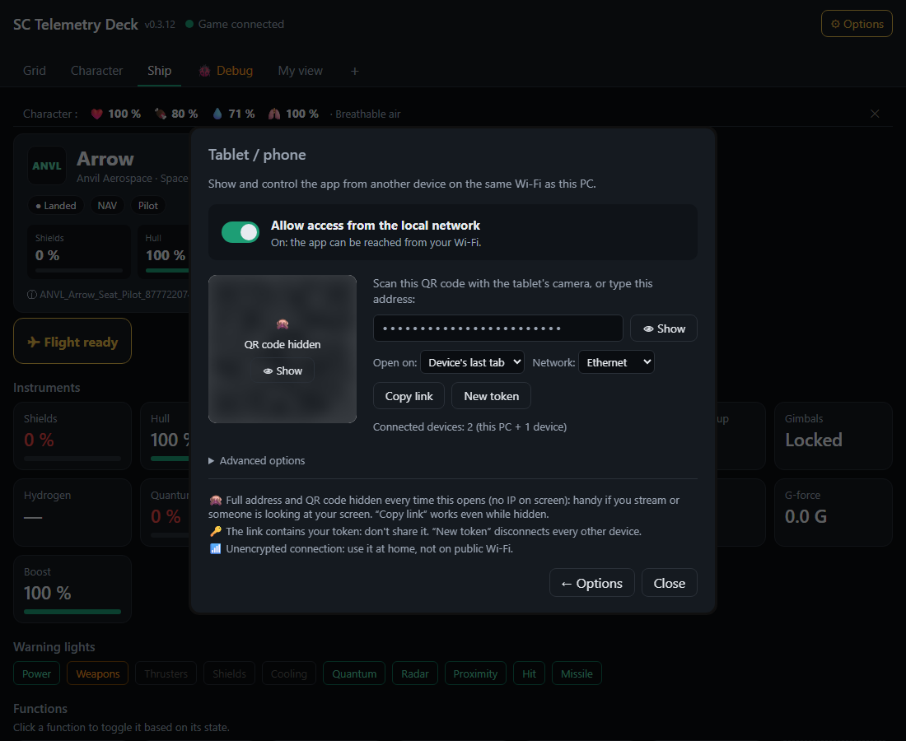
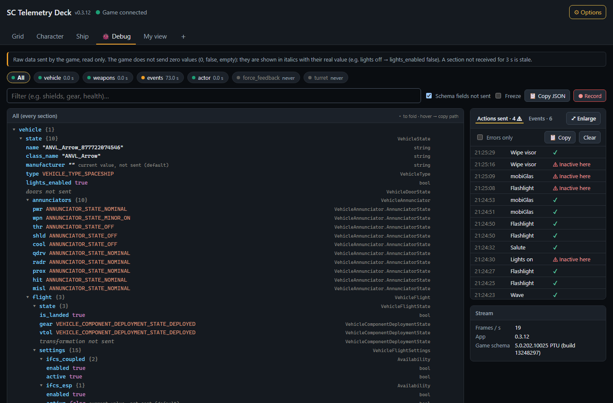
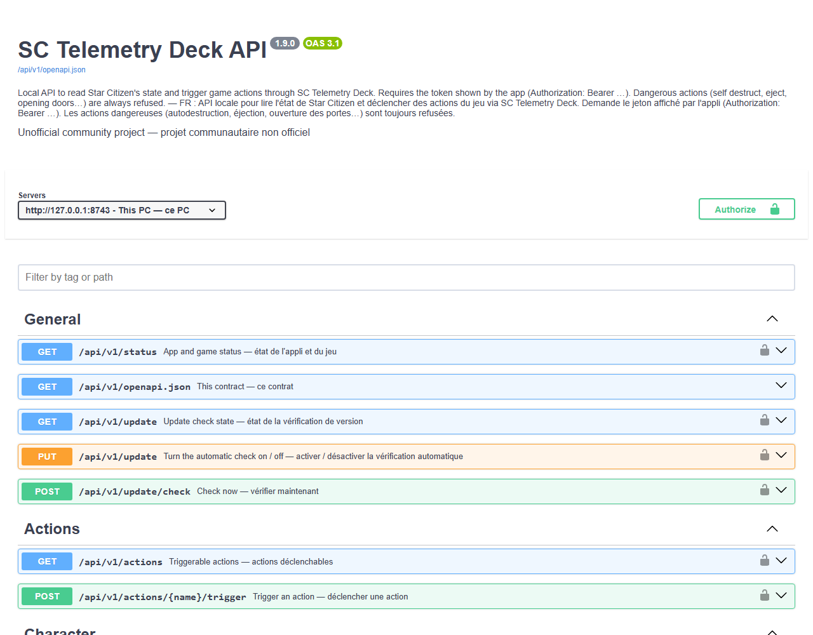

# SC Telemetry Deck

> [!CAUTION]
> **Not working on the current 5.0 PTU (25 Nov 2026).**
> Since PTU build **5.0.202.35026** (CL 13273298, built 24 Nov 2026), the game client no longer starts its local telemetry service: nothing listens on `127.0.0.1:2942`, so the plugin and the web app get no data and actions fail.
> This is a change on the game side, not a bug in SC Telemetry Deck, and there is nothing to fix on your PC. The API is still in the game files, so it should come back in a later build: this page will be updated as soon as it does.

**EN** English · 🇫🇷 [Français](README.fr.md) · 📜 [Changelog](CHANGELOG.md)

Stream Deck plugin **and standalone web app** for **Star Citizen**, built on the game's local telemetry API (gRPC, `127.0.0.1:2942`).

- Trigger the actions the game exposes (emotes, flashlight, lights, landing gear, doors once the game accepts them, master mode…) and see the ship's real state on the key
- Show your character's vitals on your keys and Stream Deck + dials (oxygen, health, temperatures…)
- No Stream Deck? Use the same buttons in your browser, with Character and Ship tabs and a documented API
- No game modification, no memory reading: only the local API provided by the game client

## Contents

- [Demo](#-demo)
- [Highlights](#highlights)
  - [Tablet and phone](#tablet-and-phone)
  - [Debug tab](#debug-tab)
  - [Public API](#public-api)
- [Installation](#installation)
- [Requirements](#requirements)
- [Enabling telemetry in Star Citizen](#enabling-telemetry-in-star-citizen)
- [Stream Deck actions](#stream-deck-actions)
- [The API in short](#the-api-in-short)
- [Web app and public API](#web-app-and-public-api)
- [Plugin development](#plugin-development)
- [Tools](#tools-tools)
- [Known limitations](#known-limitations)
- [License](#license)

## 🎬 Demo

[](https://youtu.be/t30sASa_oD4)

▶️ [Watch on YouTube](https://youtu.be/t30sASa_oD4)

> ⚠️ Unofficial community project, not affiliated with Cloud Imperium Games or Elgato.
> The API is not documented by CIG and may change with any patch.

> [!WARNING]
> **Beta** — tested in game, but the telemetry API is new, undocumented by CIG and may change with any patch.
> What works depends on your game version: **4.10.3 (LIVE) = display only**, **5.0 (PTU) = display + actions**.
> See [Known limitations](#known-limitations). Problems or ideas: [Issues](../../issues).

## Highlights

### Tablet and phone

No Stream Deck? Use your phone or an old tablet as a touch panel for the game. You install nothing on the device.

- Scan the QR code that the web app shows on the PC. The device must be on the same Wi-Fi. The page opens in its browser.
- Use the same buttons and live gauges as on the PC. Buttons show the ship's real state (landing gear, lights, VTOL, power…), so they stay in sync with the game.
- Give each device its own view: ship on the tablet, character on the phone. Build views by drag and drop, and give them a **ship HUD** look with rings, arcs and gauges. **🔁 Auto** switches the view when you leave your seat or start an extravehicular activity (EVA).
- Access is off by default and limited to your local network. The QR code and the IP address stay hidden until you click **👁 Show**, so you can stream safely.

<p align="center">
  
  
</p>

To set it up, see **Tablet / phone** in [Web app and public API](#web-app-and-public-api).

### Debug tab

The Debug tab shows everything the game sends. Use it to check what your ship really exposes, or to attach data to a bug report.

- Each section updates live and shows its age. The full tree shows in grey the schema fields that the game does not send.
- **⏺ Record** saves the raw stream to a `.json` file.
- The action log lists the last 200 actions sent, with the game's answer and the response time.

To turn it on, go to **⚙ Options > Advanced (this device) > Debug mode**.

<p align="center"></p>

### Public API

The web app exposes a documented REST API for stream overlays, bots, dashboards, and home automation.

- Open the Swagger UI at `http://127.0.0.1:8743/api/docs` to read the OpenAPI contract and try each request in your browser.
- Read the character, the ship instruments, the warning lights, and the ship functions.
- Trigger actions, press ship functions, and manage views.
- Receive real-time updates with Server-Sent Events (SSE) at `/api/v1/events`, without polling.
- Every request needs the access token (`Authorization: Bearer …`). By default, the API answers on this PC only.
- Read the [web app API reference](docs/api/web-app-api.md) for every endpoint, with examples.

<p align="center"></p>

---

## Installation

1. **Enable telemetry in Star Citizen** — [see the steps below](#enabling-telemetry-in-star-citizen) (one command on 4.10.3 LIVE, one line in `user.cfg` on 5.0 PTU).
2. Download the files from the latest [release](../../releases/latest):
   - **Stream Deck plugin**: `com.sokren.sc-telemetry.streamDeckPlugin` — double-click it, the Stream Deck app installs it. The actions appear under the **Star Citizen** category.
   - **Web app** (no Stream Deck needed): `sc-telemetry-web.exe` — a single file, nothing to install. Double-click it: the page opens in your browser. Windows may show a SmartScreen warning the first time (the file isn't signed): *More info → Run anyway*. After a game patch, you can drop an updated `sc_extrait.desc` / `actions.json` next to the exe.
   - **Web app, portable version**: `sc-telemetry-web-<version>-portable.zip` — for PCs where **Windows Smart App Control** blocks the exe (a "potentially dangerous app" box with only *OK*). Same app, started with the official, signed `node.exe`. Before extracting: right-click the zip → *Properties* → tick **Unblock**, then *Extract All* and double-click `SC Telemetry Web.cmd`. If it is still blocked, unblock the `.cmd` the same way, or run `.\runtime\node.exe app\server.mjs` in a terminal opened in the folder (details in the `README.txt` inside the zip).

## Requirements

| | Minimum version |
|---|---|
| Star Citizen | **4.10.3 (LIVE)**: information display only · **5.0 (PTU)**: everything (display + actions — `TriggerGameAction` only appears in 5.0) |
| Stream Deck (app) | 7.1 |
| Node.js (development only) | 24 |

## Enabling telemetry in Star Citizen

The local telemetry server is **disabled by default**. How to turn it on depends on the game version. These steps are also in the web app: **❓ Enable telemetry** button, shown while the game sends nothing.

### Star Citizen 4.10.3 (LIVE) — environment variable

1. Close the game **and the RSI Launcher** completely (also its icon next to the clock).

2. Open **PowerShell** (Start menu → type `PowerShell`) and run:
   ```powershell
   setx GRPC_CLIENT_SERVER_ENABLED true
   ```
   It answers `SUCCESS: Specified value was saved.` The variable is saved for your Windows account: doing it once is enough.

3. Start the **RSI Launcher**, then the game. The launcher must be started *after* the command: it passes the variable on to the game.

4. Spawn your character: the keys and the web page show your vitals and your ship's state. On 4.10.3, actions (emotes, ship commands…) can't be triggered — see [Known limitations](#known-limitations).

### Star Citizen 5.0 (PTU) — `user.cfg`

1. Close the game, then go to the folder of the game channel you play, for example:
   ```
   C:\Program Files\Roberts Space Industries\StarCitizen\PTU\
   ```
   (Your install folder may differ.)

2. Open the `user.cfg` file there. If it doesn't exist, create it: in Notepad, *File → Save as*, file name `user.cfg`, type **All files** (not `user.cfg.txt`).

3. Add this line and save:
   ```ini
   server.game.telemetry.enabled=1
   ```

4. Start the game. In `Game.log` (same folder) you should find:
   ```
   [User CFG ] server.game.telemetry.enabled=true
   <Register Service> Service 'sc.game.telemetry.v1.GameTelemetryService' registered
   <GameTelemetry> Local services server is running on 127.0.0.1:2942
   ```

5. The stream only starts once your character has **spawned** (line `Initializing game telemetry component of local player`). Until then, keys and the web page show "—".

The server only listens on `127.0.0.1`, without TLS or authentication: it is not reachable from the network.

### Linux (Wine / LUG)

Thanks to [u173487](https://github.com/u173487) for these steps ([issue #1](../../issues/1)). On 4.10.3 LIVE the environment variable goes into the game's Wine prefix instead of `setx`:

1. Point to your Star Citizen prefix (the `exec` line of your launcher file, without `sc-launch.sh` at the end):
   ```bash
   export WINEPREFIX="/path/to/your/star-citizen/prefix"
   ```
2. Add the variable:
   ```bash
   wine reg add "HKCU\\Environment" /v GRPC_CLIENT_SERVER_ENABLED /t REG_SZ /d true /f
   ```
   It answers `reg: The operation completed successfully`.
3. Check it:
   ```bash
   wine reg query "HKCU\\Environment" /v GRPC_CLIENT_SERVER_ENABLED
   ```
   Expected: `GRPC_CLIENT_SERVER_ENABLED    REG_SZ    true`.
4. Restart the Wine server so the game picks it up, then start the game:
   ```bash
   wineserver -k
   ```

On 5.0 PTU, the `user.cfg` line above should be enough, since the file is in the game folder inside the prefix (not tested on Linux yet). The Stream Deck plugin is Windows only; on Linux, use the web app: run `sc-telemetry-web.exe` with Wine, in the same prefix.

## Stream Deck actions

| Action | What it does |
|---|---|
| **Actor Action** | triggers a character action (mobiGlas, flashlight, star map, visor wipe) or an emote (34). Grouped dropdown "Character" / "Emotes", provided by the game when it is running, otherwise by the `schema/actions.json` snapshot. ✔ when the game accepts, ⚠ otherwise (reason in the plugin log). |
| **Morse Code** | flashes the **flashlight** or the **ship's lights** in Morse code: light, text, dot length (100–2000 ms) and repetitions are configurable. During playback, the key shows the current letter and its code (the lit sign in bold, `␣` between words, the round when the message repeats). Pressing again during playback stops it and turns the light off. ⚠ The flashlight must be off at start (the game does not expose its state); the ship's lights are switched on / off explicitly (seated in a ship). |
| **Actor Display** | shows a character vital, live: health, oxygen, hunger, thirst, body / outside temperature, heart rate, gravity, pressure, radiation, intoxication, breathable air, balance; and, since 5.0 PTU (build 13273298): the character's **mode** (flight, mining…), **location**, **CrimeStat** (red bar), **armistice zone** (green bar), **tracked mission** (objectives done / total), **FPS** and **ping**. On a key: value + colored gauge (green ≥ 50 %, orange 25–50 %, red < 25 %). On a Stream Deck + dial: value and gauge on the touchscreen, **rotate to change the value**. "—" when the game is closed or the character has not spawned. |
| **Ship Display** | shows a ship value, live: **countermeasures** — decoys and noise together ("45 / 3"), or one of them —, **weapons ready to fire** ("1 / 2"), the **active weapon group**, the **gimbals** (locked / free), the **ship** (manufacturer, model, flying / landed), **shields**, **hull**, **speed**, **vertical speed**, **radar altitude**, **G-force**, **boost reserve** ("Boost ▲" while engaged), **hydrogen** or, since 5.0 PTU (build 13273298), **quantum travel** (time left and destination, calibration % while aligning), **distance left** and **calibration**. Same look as Actor Display: value + colored gauge on a key, touchscreen + **rotate to change the value** on a Stream Deck + dial. The game does not send the maximum stock: 100 % = the largest stock seen for this ship model **while a plugin display is visible**. "—" when the game is closed, the character is not seated, or the ship does not send that value (countermeasure, weapons, boost, hydrogen…). Display only: the game exposes no command to fire countermeasures, change the weapon group or lock gimbals. |
| **Ship Action** | ship and seat commands (flight ready, ATC, ping, hail, quantum, seat modes…), grouped dropdown like Actor Action. **Functions with a state are merged into one entry** (landing gear, lights, VTOL, transformation, decoupled, G-safe, cruise control — read only, use Alt+C in game —, proximity assist, ESP, advanced HUD, night vision, NAV/SCM mode, engine / weapon / shield power, main power, doors, door locks) and **the key shows their live state**: an icon that changes with the state, a short "pop" when it changes, an animation while moving; "—" outside a ship or when the ship lacks the function. Per key: **mode** (toggle based on the state read, on, off — "On" on a function already on sends nothing), **image** (A text, B LED, C filled, or no state: fixed icon) and **red warning** (red outline and ⚠ when doors or locks are open). Sensitive actions (self-destruct, emergency exit, opening / unlocking doors, main power off…) are sent in one press; **Eject** must be held 1.5 s (a red ring fills up, releasing earlier cancels). *Ship Toggle* (before 0.3.14) is merged into it: keys already placed keep working. |

Labels follow the Stream Deck app language (French, otherwise English). On keys that draw their own image (Ship Action with a state, Actor Display, Ship Display), the **title** typed in the Stream Deck replaces the displayed name; empty title = default name.

## The API in short

Full page, with the status by game build, the stream sections, useful paths and known limitations: [Star Citizen local telemetry API](docs/api/game-telemetry-api.md).

Service `sc.game.telemetry.v1.GameTelemetryService`:

| RPC | Purpose |
|---|---|
| `TelemetryStream` | continuous stream (~17 frames/s): character, vehicle, weapons, events, force feedback, turret |
| `ListTriggerableActions` | list of triggerable actions (112 in 5.0 PTU, see [schema/actions.json](schema/actions.json)) |
| `TriggerGameAction` | triggers an action by name (`action_name`, optional `hold_ms`) |

The server does not support gRPC reflection: you need the schema (`.proto` / `.desc`).
The schema is embedded in `StarCitizen.exe`; `tools/sc_extract_proto.py` rebuilds it (see [schema/](schema/README.md)).

Quick test with [grpcurl](https://github.com/fullstorydev/grpcurl):
```cmd
grpcurl -plaintext -protoset schema/sc_extrait.desc -d "{}" 127.0.0.1:2942 sc.game.telemetry.v1.GameTelemetryService/ListTriggerableActions
```

## Web app and public API

For players **without a Stream Deck**: the same buttons and displays in a browser, served by a small local app. It also exposes a documented **public API (OpenAPI / Swagger)** that any other software can use (stream overlay, bot, dashboard…).

```powershell
npm install
npm run build:web
npm run start:web        # opens the page in your browser (add -- --no-open to skip)
npm run build:exe        # builds dist\sc-telemetry-web.exe (single file, Node SEA)
npm run build:portable   # builds dist\sc-telemetry-web-<version>-portable.zip (signed node.exe + app, for Smart App Control)
```

- Page: `http://127.0.0.1:8743/` — the app opens it with the access token included. Tabs: **Grid** (buttons), **Character** (position, crew role, all 13 vitals, an **Actions** row — star map, wipe visor, mobiGlas, flashlight — and the 34 emotes, clickable), **Ship** (a big **✈ Flight ready** button, a one-line **character summary** — health, hunger, thirst, oxygen, breathable air; hide it with ✕ or in ⚙ Options —, a **My ship** card — model, manufacturer, flying / landed, mode, role, boost —, instruments — including decoys and noise countermeasures, weapons ready, weapon group, gimbals, vertical speed, G-force and boost reserve —, warning lights and the 18 functions, clickable except read-only cruise control) and **your views** (first one: **My view**; **＋** adds more, up to 10): your own layouts, with named sections (half or full width) and the items you pick from an **Add** menu (vitals, instruments, warning lights, ship functions, actions, emotes, **Morse**: a saved message — text, flashlight or ship lights, speed, repetitions, set with ✏️ — or a free field to type a message on the spot; while sending, the item shows the current letter and its code, the lit sign highlighted), moved by drag and drop (mouse or touch). Unlock a view with the padlock to edit, rename or delete it, lock it to use it. Views are saved in the app (`view.json` next to `settings.json`) and kept when it restarts: one view per screen (PC, tablet, phone…), and a link ending in `?view=<id>` opens a given view directly (the device remembers it; the tabs, or a list on a phone, switch views). **⚙ Options**: color theme (Default, Green cockpit, Amber, Night blue, Light) and accent color, language (one button per language), number format (1 234,5 or 1,234.5, whatever the language), automatic view, tablet / phone access and help — theme, language, number format and automatic view are remembered per device. **🔁 Auto** (per device, in ⚙ Options): opens a chosen view by itself when your character is on foot, seated or in EVA, after 2 s in the same position, never while you edit a view.
- **Export / import a view** (padlock open, **⇪ Export** / **📥 Import**): one view or all your views, as a `.json` file (backup) or as a **copy-and-paste code** (`SCTD1:…`, for Discord, Reddit…). On import, a preview tells which version exported the view and lists the items your version cannot read (they are left out, the rest is imported); imported views are added to yours, nothing is replaced. API: `GET /api/v1/views/export` (`?id=`, `&as=code`), `POST /api/v1/views/import` (`?dry_run=1` for the preview).
- **Customize a view** (padlock open): **Look** at the top of the view — *Standard* or *Ship HUD* (cockpit-screen frames, monospaced figures, colors of your theme). Each item gets a **⚙** button: a **display name** (any text, any language, emojis — the game name otherwise; only the view changes, not the API or the Stream Deck) and a **style** for gauges — card, ring, arc, bar, vertical bar, segments, vertical segments or big number (values without a maximum, like speed: card or number). For the balance, ⚙ also picks the **scale**: auto (15.0M), thousands (15,021k), millions (15.02M) or every digit. **Width** in slots with the “2 → 3” button: 8 slots per row in a full-width section, 4 in a half section or on a phone. Older views keep their layout.
- **View templates**: **＋** offers *Blank* or a ready-made template, such as **Xeneon Edge – pilot** (pilot station for a wide 2560×720 touch screen: flight, power, quantum, landing and character). The new view can then be edited like any other. The same template is provided for import in [`docs/vues/`](docs/vues/) (FR / EN `.json` and `SCTD1:` code). Sections can be **full, half or one third** of the width (**−** / **+** buttons) and **tall** (↕, two rows); an item's width is also set with **−** / **+** (1 to 16 slots) and a dragged item lands in the column where you drop it (empty slots, centered button…); the **Cockpit** look follows the pilot station style, and new styles join ⚙: **heading tape** (heading), **switch** (ship functions, e.g. SCM / NAV), **slide** or **hold 1.5 s** to confirm an action (e.g. self-destruct), plus the **line** style (name and value on one line) and the **BOOST** light (grey, lit while you boost).
- Swagger UI: `http://127.0.0.1:8743/api/docs` — contract: `/api/v1/openapi.json`.
- Every API call needs a token (`Authorization: Bearer …`), stored in `%APPDATA%\SC Telemetry Deck\settings.json`: the **admin token** works only on the PC; the **mobile token**, shared by tablets and phones, comes with the QR code and has the page's rights without the settings (local network, tokens, plugins, updates).
- **Updates** (⚙ Options): the app checks GitHub at start and then daily for a newer version (only reads the public releases and offers main versions only — pre-releases, betas and release candidates are ignored —; sends no data; can be turned off). When one exists, a **⬆ x.y.z available** badge appears in the header and **Open GitHub ↗** leads to the release page — download it yourself and replace the exe (close the app first). Nothing is downloaded automatically.
- **🧭 Instrument panel**: a ready-made tab for a tablet next to the keyboard — quantum travel as a ring, ship and character as notched gauges, functions, tracked mission, performance; monospace numbers, a single accent colour (the theme's). Built-in view: it does not count toward the 10 views and cannot be edited; for a version of your own, create a view from the *Instrument panel* template (＋ New view). The same style is also a **look** for any view (*Instrument panel*). To open it directly on the tablet: ⚙ Options → Tablet / phone → *Open on*: Instrument panel (link `?view=instrument`).
- **New in game 5.0 PTU (build 13273298)** — shown only when the game sends them (this build does not open the local API yet: not checked in game): **game state** in the top bar (main menu, loading, in game, menu open); **Ship** tab: a **Quantum travel** card next to "My ship" (destination, time left, distance, spool and calibration); **Character** tab: **player name, mode** (flight, combat, mining, salvage…), **location** and jurisdiction, **armistice zone**, **CrimeStat**, and a **Tracked mission** section (current objective, objectives done / total, time left); **Debug** tab: a **Performance** section (FPS, CPU / render / GPU times, video memory, ping, packet loss, server, shard — maybe only with `server.game.telemetry.debug.displayinfo`), frame number and **lost frames**. All of them are also **My view items** (**Add** menu: Character, Ship and **Game** tabs). **🔁 Auto**: a view can open **by the character's mode** (mining → your "Mining" view…), taking priority over position when a view is chosen. API: `GET /api/v1/game`; new fields in `/api/v1/character` and `/api/v1/ship/status` (contract **1.12.0**).
- **🐞 Debug mode** (⚙ Options → *Advanced*, per device): adds a **Debug** tab with **everything the game sends**, raw and read only — every section with its age (green = live, orange = stale, grey = never received), or **All** at once; the full tree with the **schema fields the game does not send** in grey (to see what a ship really exposes); filter, freeze, copy JSON or a path; the last game events; frames per second. **⏺ Record** saves every raw frame (up to 10 000, about 10 min) and downloads them as a `.json` file — handy to attach to a bug report. The Debug tab also lists the **last 200 actions sent** by the web app and the API (time, action, origin — Character, Ship, view, grid or API —, character position, the game's answer such as *not allowed in this situation* / FILTERED or *refused* / FAILED, response time), with *Errors only*, *Copy* and *Clear*; they are added to the recording. A button that shows ⚠ explains why when hovered. API: `GET /api/v1/debug`, `POST` / `DELETE /api/v1/debug/recording`, `DELETE /api/v1/debug/actions`.
- **Tablet / phone** (in ⚙ Options, on the PC only): turn on **Allow access from the local network**, then scan the **QR code** with the tablet's camera (same Wi-Fi as the PC). The QR code and the full address are **hidden** every time the window opens (no IP on screen, handy when streaming); **Copy link** works even while hidden. **Open on** picks the view the link opens. **New token** replaces the mobile token: every tablet and phone must scan the QR code again, the PC stays connected. The first time, Windows may ask to allow the app through the firewall: tick **Private networks**.
  - Off by default: the app then listens on **this PC only** (`127.0.0.1`). On: this PC plus the chosen network card (virtual cards — WSL, Hyper-V, VirtualBox, VPN… — are left out). Only the PC can change these settings or see the link.
  - The connection is **not encrypted** and the link contains the mobile token (never the admin token): use it at home, not on public Wi-Fi. If a link leaks, **New token** cuts the mobiles off without touching the PC.
  - Advanced option, **at your own risk**: **Listen on all interfaces (0.0.0.0)** exposes the app on every network card of the PC (VPNs, virtual machines, public Wi-Fi…): anyone there who gets the link can control the game.
- **External access** (⚙ Options, on the PC only): **named tokens** for your other software (VoiceAttack, overlay, bot…), each at one level — **Read** (game state, events), **Pilot** (plus actions, ship functions, Morse, without eject, self destruct or unlocking) or **Full pilot ⚠** (with those protected actions, always flagged in red) — and usable or not from the local network. The token is shown only once; then: **renew** (the old one stops working at once), **stop** for 15 min, 1 h or until resumed, **revoke**, and a **live log** of the last calls (yellow ⚠ when there are unseen errors; every dangerous action sent is flagged “sensitive action”). The app token (page, Stream Deck) is unchanged. API: `/api/v1/access/tokens`; a tool learns its own rights with `GET /api/v1/access/me`.
  Example: [fly the ship by voice with VoiceAttack 2](examples/voiceattack/README.md) (Pilot token, spoken replies and alerts).
- **Plugins** (⚙ Options → Plugins, on the PC only): **programs** the app starts next to it, put in the `plugins` folder **next to the app** (one folder per plugin, with a `plugin.json`). Any language: Node, Python or an `.exe`. A **new or changed plugin never starts on its own**: the enable window shows the exact command (run without a shell), the files and their fingerprint, the level it asks for (you can give a lower one) and its rights on your views (**read**, **change** the ones you pick, **create** its own views). Each plugin gets its own token, which only exists while it runs and only works from this PC. **A plugin is a program that runs with your rights**: only enable code you can read, from a source you know. A Node plugin can only read its own folder; others do not have that protection. The level limits what a plugin does with the app's API, not with the game: the game's local API has no token, any program running on the PC can reach it. In the top bar, **🧩 N plugins**: green, orange when there are unseen errors, red when a plugin has **failed** (3 errors in 1 minute). Example: [`examples/plugins/`](examples/plugins/). API: `/api/v1/plugins`.
- Same rules as the plugin for sensitive actions: one press, except **Eject**, held 1.5 s.

## Plugin development

```powershell
npm install
npm test                 # tests (fake gRPC server built on the real schema)
npm run build            # builds com.sokren.sc-telemetry.sdPlugin\bin\plugin.js and copies schema\ into data\
npx streamdeck validate com.sokren.sc-telemetry.sdPlugin
npx streamdeck link com.sokren.sc-telemetry.sdPlugin   # once; then restart the Stream Deck app
npm run watch            # rebuilds and restarts the plugin on every change
```

Plugin log: `com.sokren.sc-telemetry.sdPlugin\logs\`.

### Publishing a release

```powershell
npm test; npm run build
npx streamdeck pack com.sokren.sc-telemetry.sdPlugin -o dist -f
git tag -a vX.Y.Z -m "SC Telemetry Deck X.Y.Z"; git push origin main vX.Y.Z
gh release create vX.Y.Z dist\com.sokren.sc-telemetry.streamDeckPlugin --title "SC Telemetry Deck X.Y.Z" --notes-file docs\releases\vX.Y.Z.md
```

Release notes live in `docs/releases/vX.Y.Z.md` and are **bilingual**: English first, then French, separated by a `---` line.
Update `Version` in the manifest before packing.

## Tools (`tools/`)

Standalone Python scripts (`pip install grpcio protobuf`):

| Script | Purpose |
|---|---|
| `sc_extract_proto.py` | extracts the schema from `StarCitizen.exe` and compares it with an existing one |
| `sc_champs_inconnus.py` | shows fields sent by the game but missing from the schema |
| `sc_actions_diff.py` | after a patch: lists commands added / removed in `StarCitizen.exe` (no game needed) and triggerable actions added / removed (game running), updates `schema/actions.json` |
| `sc_bridge.py` | HTTP/JSON → gRPC bridge (`http://127.0.0.1:8742/action/<name>`, `/state`, `/value/<path>`) |
| `sc_morse.py` | flashes the flashlight in Morse code (`python sc_morse.py SOS`) |
| `toggle_flashlight.pyw` | triggers the action named after the file, without a console window |

The scripts' messages and comments are in French.

## Known limitations

- **Game version**: on **4.10.3 (LIVE)**, only information display works (vitals, ship state, Character and Ship tabs). Triggering actions — emotes, ship commands, Morse — needs **5.0** (PTU for now): on 4.10.3 keys show ⚠ and the web page shows a banner.
- The **Stream Deck plugin** is Windows only; the web app also runs on Linux under Wine — see [Linux (Wine / LUG)](#linux-wine--lug).
- The **flashlight** state is not exposed (only the `toggle_flashlight` action).
- Death / respawn events exist in the schema but are not emitted: rely on health instead.
- A frame may contain only some sections; zero values (`0`, `false`) are omitted (proto3).
- Some game actions are **dangerous** (`v_self_destruct`, `v_eject`, `v_power_set_off`, opening / unlocking doors…) and the game runs them without confirmation. Keys and the web app send them in one press (Eject: hold 1.5 s); the `tools/` scripts do not filter them.

## License

To be decided.

Third-party: the web app's QR codes are made with [qrcode-generator](https://github.com/kazuhikoarase/qrcode-generator) by Kazuhiko Arase (MIT license). “QR Code” is a registered trademark of DENSO WAVE INCORPORATED.
